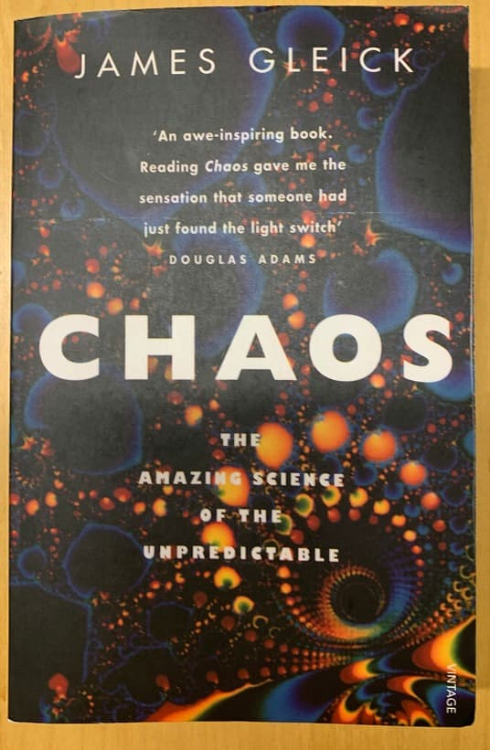

# Chaos

I stumbled upon _Chaos_ by James Gleick watching Robert Sapolsky's [lecture series](https://www.youtube.com/watch?v=NNnIGh9g6fA) on Human Behavioral Biology.

!!! quote "Robert Sapolsky"
    Chaos year after year after year in this class provokes the strongest opinions.
    
    A quarter of the people decide it is the most irritating, irrelevant thing that could possibly have been assigned in the class and hate it.
    
    About half the people never quite figure out what's up with it.
    
    And a quarter of the people, their life is transformed. They no longer have to meditate, they no longer have to have a—just they are at peace.
    At peace, I tell you.
    
    Because what this book does is introduce this whole radically different way of thinking about biology, taking apart a world of reductionism.
    For five hundred years we have all been using a very simple model for thinking about living systems, which is, if you want to understand something
    that's complicated, you break it apart into its little pieces.
    
    And once you understand the little pieces and put it back together, you will understand the complex thing.
    And what Chaos as an entire field is about—and this was pretty much the first book that was meant for the lay public about it—what Chaos shows
    is, that's how you fix clocks. That's not how you fix behaviors. That's not how you understand behaviors.
    Behavior is not like a clock, behavior is like a cloud. And you don't understand rainfall by breaking a cloud down into its component pieces
    and gluing them back together.
    
    So read through that book. A lot of it is from physical sciences rather than biological, so we'll just be suggesting the chapters you should read.
    
    I will tell you it is the first book since, like, Baby Beluga where I've gotten to the last page
    and immediately started reading it over again from the front.
    Because, along with Baby Beluga, it's had the greatest influence on my life.
    I found this to be the most influential book in my thinking about science since college. So that is a sign.
    
I needed to have this. I bought a cheap paperback, that has bad printing quality, some letters missing, and bad editorial oversight,
because the index sometimes points to wrong pages (probably where the material was in the hardcover).
Also, in the beginning around page 25, there's evidently some text missing, because the last words on one page did not possibly fit together
with the first words on the next page to construct a grammatical and meaningful sentence.

Apart from this introduction, just a few notes:

* p. 29: I should really visualize the Lorenz attractor
* p. 41: a pendulum's amplitude influences the frequency slightly, that's a non-linearity
* p. 108: equations of fluid flow are dimensionless in many contexts, so they are scale invariant
* p. 108: no cell in the human body is more than three or four cells away from a blood vessel, even though blood vessels take up
          less than five percent of the space in the body
* p. 110: DNA cannot possibly specify all the blood vessels, but it can specify a repeated process of bifurcation, which is fractal
* p. 113: A part of physics that's dead stays dead (there are reasons why it's dead/wrong).
          A part of mathematics falling into obscurity can rise again.
* p. 117: art that satisfies lacks scale, contains important elements at all sizes
* p. 122: practical interest in turbulence is usually: make it go away
* p. 125: “The experimenter's lovers sweat, complain, and fart.”
* p. 138: in the short run every point in a dynamic system's phase space is one of its possible behaviors, in the long run only the attractors are
* p. 138: search for new attractor: stable, low-dimensional, non-periodic (thus without crossings)
* p. 139: infinitely long line in finite space: fractal
* p. 160: Kadanoff: how do atoms in a metal block agree on direction of magnetising?
* p. 186: only scaling things are universal
* p. 201: difference final cause and physical/efficient cause
* p. 235: typically more than 75% of plotted points lay on the boundary
* p. 236: Julia sets and other fractals: both outcome of a deterministic process and limit of a random process
* p. 236: chaos game: head-tails rules
          writing down rules: capturing global shape information
          iteration of rules: repeating _disregarding scale_
          the more fractal a shape, the  simpler the rules
* p. 236: collage theorem: reversing the process
* p. 255: “information” is a value-free term
* p. 260: macroscales: objects, microscales: atoms (e.g. energy in temperature), both scales do not communicate with each other
          “one does not need to know the temperature to do a classical mechanics problem”
* p. 260: chaos was the creation of information
* p. 265: need at least three differential equations for chaos
* p. 265: 2-dimensional graph for 1-dimensional time-series data
* p. 281: artificial heart valves: change blood flow patterns, lead to clotting
* p. 293: Mode locking: there was also something in McElreath, Statistical Rethinking
* p. 306: John Hubbard considered chaos a poor name, because it implied randomness
* p. 308: entropy hard to pin down as a measure of disorder
* p. 314: Joseph Ford: “Evolution is chaos with feedback”
